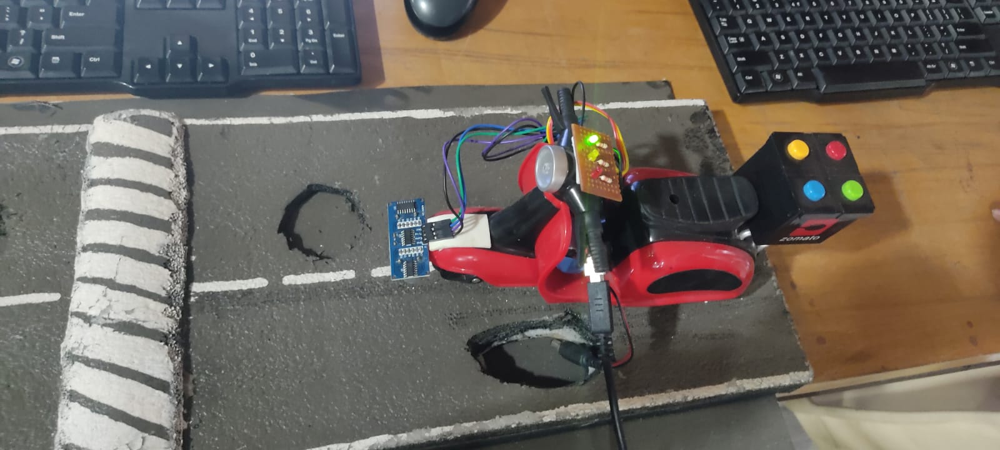
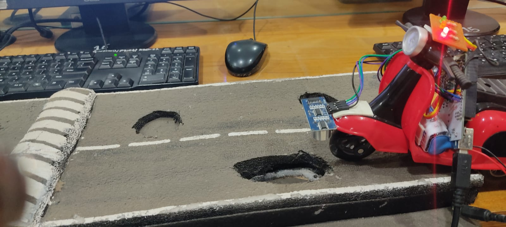
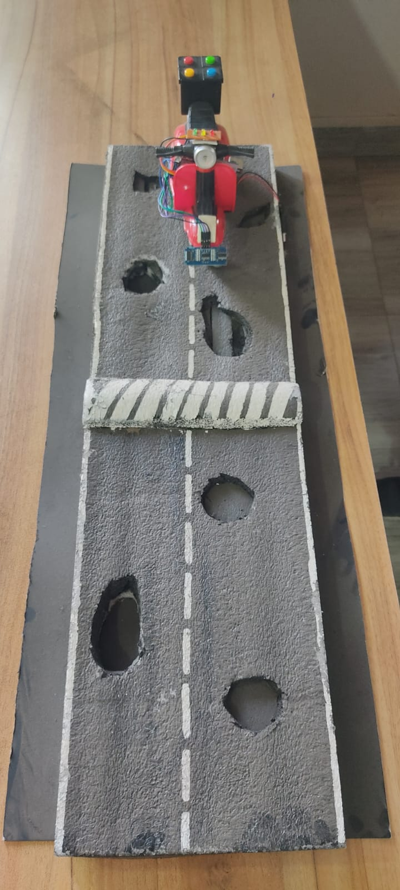
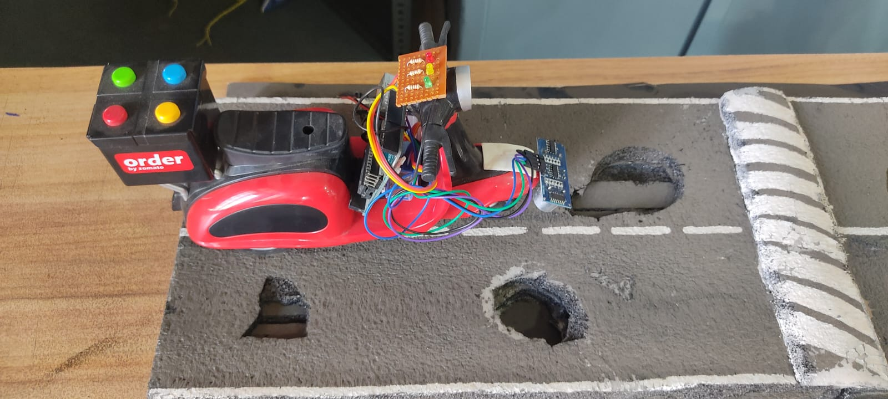
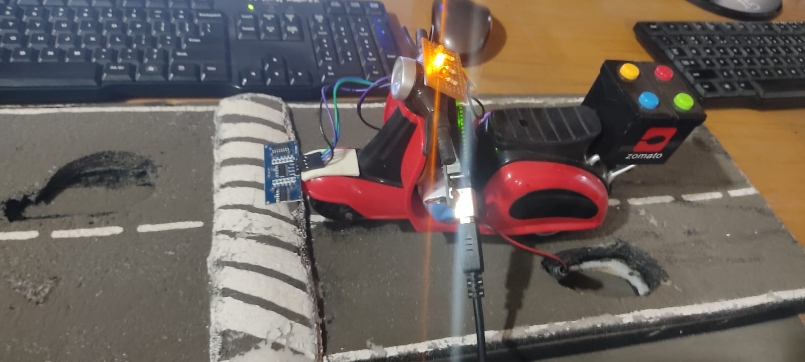

# Automatic Pothole Detector

An Arduino UNO and HC-SR05 ultrasonic sensor prototype that identifies changes in road-surface height and signals the detected condition with LEDs. A functional hardware prototype was built and tested using a miniature vehicle.

## Table of Contents

- [Introduction](#introduction)
- [Features](#features)
- [Technologies Used](#technologies-used)
- [Working Principle](#working-principle)
- [LED Indicators](#led-indicators)
- [Usage](#usage)
- [Results and Photo Gallery](#results-and-photo-gallery)
- [Limitations](#limitations)
- [Project Documentation](#project-documentation)
- [Contact](#contact)

## Introduction

Potholes and raised road features can be difficult to see, particularly in poor visibility. This academic embedded-systems project uses an ultrasonic sensor mounted on a miniature vehicle to measure the distance to the road surface. The Arduino compares the measurement with distance bands and uses LEDs to indicate a normal surface, a small irregularity, or a deeper pothole. It is a functional miniature-vehicle prototype, not a system deployed on real-world vehicles.

## Features

- Measures road-surface distance with an HC-SR05 ultrasonic sensor.
- Classifies the measurement using the thresholds in the Arduino sketch.
- Indicates the detected condition with green, yellow, and red LEDs.
- Demonstrated with a functional hardware prototype built and tested on a miniature vehicle and model road.

## Technologies Used

- Arduino UNO microcontroller
- HC-SR05 ultrasonic sensor
- Red, yellow, and green LEDs
- Arduino IDE
- Arduino C/C++ (Arduino sketch)

## Working Principle

1. The HC-SR05 repeatedly measures the distance between the sensor and the road surface.
2. The Arduino converts the echo duration into a distance measurement in centimeters and compares it against the sketch's fixed distance bands.
3. A greater distance can indicate a pothole or depression; a smaller distance can indicate a raised feature such as a speed breaker. The interpretation depends on the sensor's mounting position.
4. The sketch activates the corresponding LED for a one-second interval.

The current sketch uses these ranges: below 3 cm, 3 cm to less than 5 cm, 5 cm through 7 cm, and above 7 cm. These are fixed in the source code rather than exposed as adjustable settings.

## LED Indicators

| LED | Indication in the sketch |
| --- | --- |
| Green | Normal road surface (3 cm to less than 5 cm) |
| Yellow | Small pothole or speed breaker (below 3 cm, or 5 cm through 7 cm) |
| Red | Deep pothole (above 7 cm) |

## Usage

1. Open [`Code/PotholeDetector.ino`](Code/PotholeDetector.ino) in the Arduino IDE.
2. Connect the HC-SR05 and LEDs to the pins defined in the sketch: trigger D12, echo D13, red LED D8, green LED D10, and yellow LED D11.
3. Select Arduino UNO and the connected serial port in the IDE, then upload the sketch.
4. Power the prototype and move the miniature vehicle across the model road to observe the LED indications.

The model can be used to demonstrate the concept in scenarios such as monsoon conditions, muddy roads, construction areas, and poorly lit roads. These are potential use contexts, not claims of real-world vehicle deployment or testing.

## Results and Photo Gallery

### LED indicator examples

### Miniature vehicle prototype

[View the prototype demonstration video](Images/Prototype/Miniature-Vehicle-Demonstration.mp4).

## Limitations

- The sensor's usable range is limited by the HC-SR05 module and its mounting position.
- Dust can affect sensor readings.
- The distance thresholds are fixed in the sketch and depend on sensor placement.
- LEDs are illuminated for one-second intervals on repeated detection cycles; frequent activation adds to the prototype's power consumption.

## Project Documentation

- [Official Project Report](Documentation/Official-Project-Report.pdf)
- [Zonal-Level Report](Documentation/Zonal-Level-Report.docx)

## Contact

[Sanskruti Joshi on GitHub](https://github.com/sanskruti-joshi)
